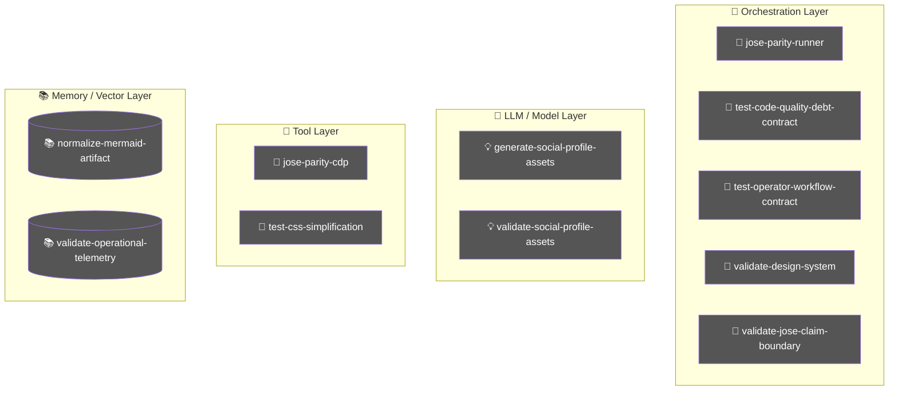
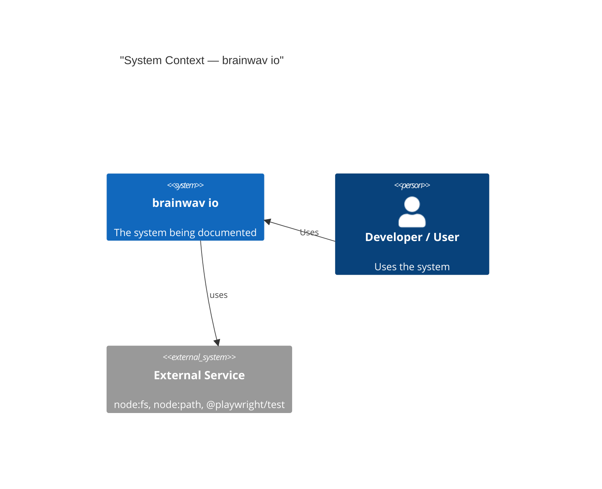
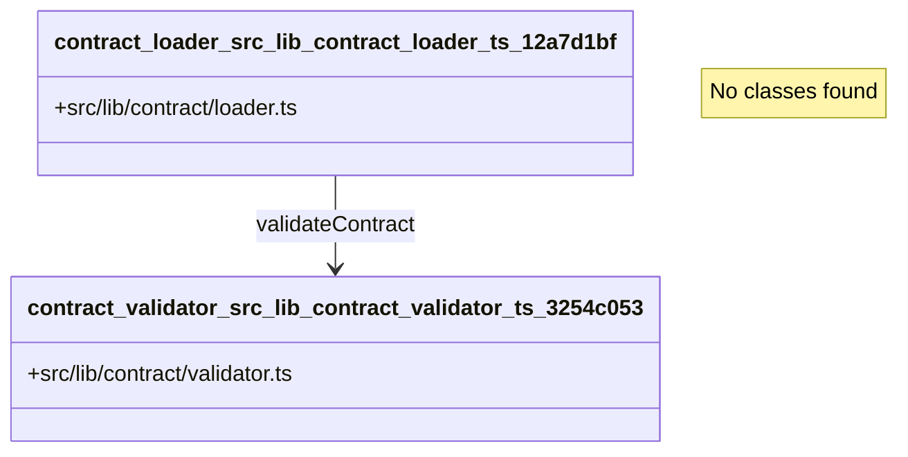
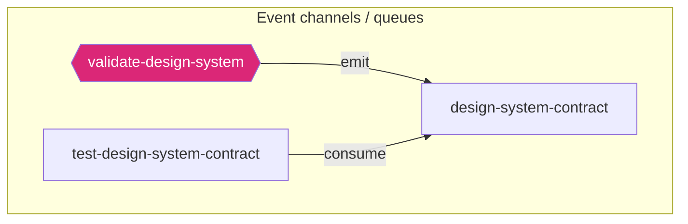
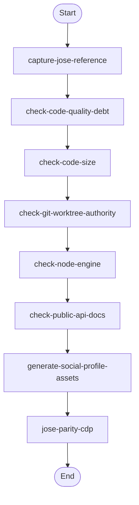
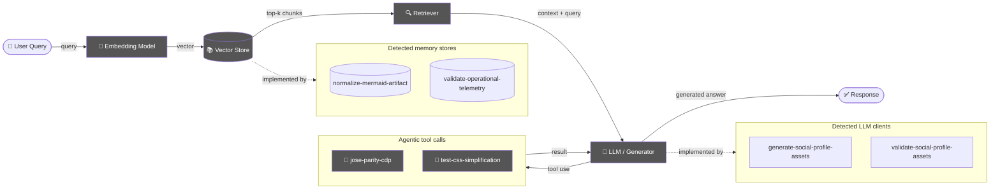
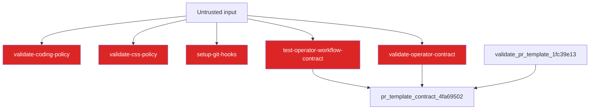
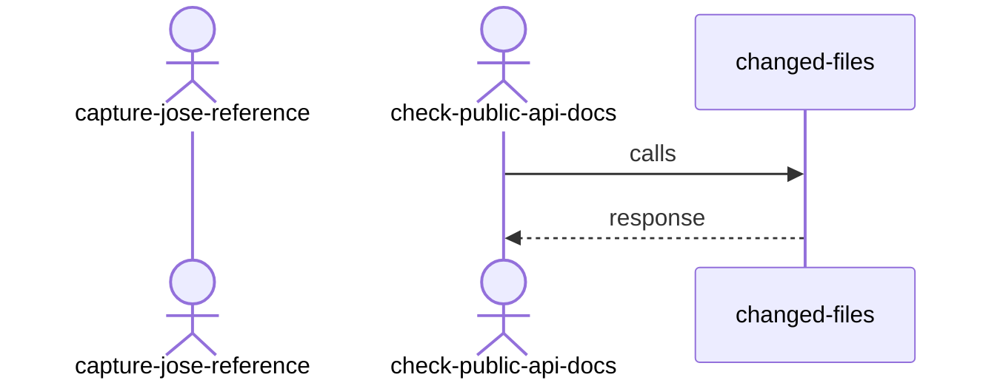
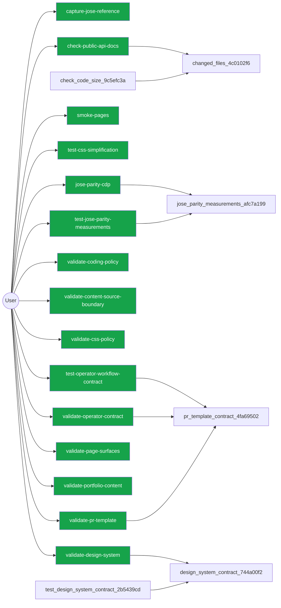

# Diagram Context Pack

Generated: 2026-08-13T20:01:06Z

## Table of Contents

- [How to use this pack](#how-to-use-this-pack)
- [agent](#agent)
- [architecture](#architecture)
- [auth](#auth)
- [c4context](#c4context)
- [class](#class)
- [database](#database)
- [dependency](#dependency)
- [erd](#erd)
- [events](#events)
- [flow](#flow)
- [rag](#rag)
- [security](#security)
- [sequence](#sequence)
- [user](#user)

## How to use this pack

- Start here for compact architecture, dependency, database, and ERD context before opening raw source files.
- Use .diagram/manifest.json to choose a focused Mermaid file when this combined pack is too large.
- For TypeScript implementation detail in this checkout, run `bash scripts/harness-cli.sh source-outline <path> --json` first, then unwrap one symbol with `--symbol <name>`. Downstream repositories can use `harness source-outline <path>`.

## Changed source focus

- These architecture-sensitive paths changed on the current branch and may be compacted out of Mermaid diagrams.
- `package.json`
- `src/brand/approved-live-banners.json`
- `src/brand/source/approved/jamie-linkedin-background-1584x396.png`
- `src/brand/source/approved/jamie-x-header-1500x500.png`
- `src/components/AnimatedButton.astro`
- `src/components/SiteNav.astro`
- `src/layouts/BaseLayout.astro`
- `src/pages/blog/index.astro`
- `src/pages/index.astro`
- `src/scripts/flip.ts`
- `src/scripts/lapse-dev.ts`
- `src/styles/global.css`
- `src/styles/route-rhythm.css`
- `src/styles/shell.css`

## agent



## architecture

```mermaid
graph TD

```

## auth


## c4context



## class



## database


## dependency

```mermaid
graph LR
  node_capture_jose_reference_e7b66705_7f5ac43a["capture_jose_reference_e7b66705"]
  node_changed_files_4c0102f6_bfd165bc["changed_files_4c0102f6"]
  node_check_code_quality_debt_cba04f67_104c73f4["check_code_quality_debt_cba04f67"]
  node_check_code_size_9c5efc3a_154124ae["check_code_size_9c5efc3a"]
  node_check_git_worktree_authority_940ab26d_54e5636e["check_git_worktree_authority_940ab26d"]
  node_check_node_engine_217689bf_3e5964b2["check_node_engine_217689bf"]
  node_check_public_api_docs_a9604f1b_f824853c["check_public_api_docs_a9604f1b"]
  node_content_config_a9a9d2e1_05943ac5["content_config_a9a9d2e1"]
  node_generate_social_profile_assets_f4f94011_2a983f29["generate_social_profile_assets_f4f94011"]
  node_jose_parity_cdp_bdcde21d_edb59c81["jose_parity_cdp_bdcde21d"]
  node_jose_parity_runner_50cc4344_e9555b02["jose_parity_runner_50cc4344"]
  node_lapse_dev_f2526c24_d04b45a0["lapse_dev_f2526c24"]
  node_pr_readiness_boundaries_621e369e_7f0b2de9["pr_readiness_boundaries_621e369e"]
  node_setup_git_hooks_70750d40_b4ca2cf9["setup_git_hooks_70750d40"]
  node_smoke_pages_9a92b30d_72f6805f["smoke_pages_9a92b30d"]
  node_test_astro_anti_patterns_88db0377_401e86a9["test_astro_anti_patterns_88db0377"]
  node_test_branch_transition_preflight_1665655e_acac1534["test_branch_transition_preflight_1665655e"]
  node_test_code_quality_debt_contract_569cff13_2953095a["test_code_quality_debt_contract_569cff13"]
  node_test_codex_preflight_receipt_200ab781_029a12e8["test_codex_preflight_receipt_200ab781"]
  node_test_css_simplification_05516724_6f0b8da9["test_css_simplification_05516724"]
  node_test_design_system_contract_2b5439cd_a676eb9e["test_design_system_contract_2b5439cd"]
  node_test_diagram_freshness_opt_in_96293749_08c46e10["test_diagram_freshness_opt_in_96293749"]
  node_test_git_worktree_authority_e031ba7e_d149c121["test_git_worktree_authority_e031ba7e"]
  node_test_harness_cli_public_fallback_ad793eff_5fbe4aa9["test_harness_cli_public_fallback_ad793eff"]
  node_test_jose_parity_measurements_2477824f_5f030e16["test_jose_parity_measurements_2477824f"]
  node_test_operator_workflow_contract_b4a152d7_c294797c["test_operator_workflow_contract_b4a152d7"]
  node_test_portfolio_helpers_88b404c3_859ed297["test_portfolio_helpers_88b404c3"]
  node_test_pr_readiness_fbe81eba_0ec78421["test_pr_readiness_fbe81eba"]
  node_test_setup_git_hooks_syntax_c035405d_68ddd381["test_setup_git_hooks_syntax_c035405d"]
  node_validate_astro_anti_patterns_c2656e62_cf436b7a["validate_astro_anti_patterns_c2656e62"]
  node_validate_coding_policy_29976175_c710e9cd["validate_coding_policy_29976175"]
  node_validate_commit_msg_43b008fe_f9560ef9["validate_commit_msg_43b008fe"]
  node_validate_content_source_boundary_8a6f121b_b79b7423["validate_content_source_boundary_8a6f121b"]
  node_validate_css_policy_1c5ec854_8f6d9474["validate_css_policy_1c5ec854"]
  node_validate_design_system_b8a5f37c_d69ca690["validate_design_system_b8a5f37c"]
  node_validate_html_output_736c5b7a_1b91e628["validate_html_output_736c5b7a"]
  node_validate_jose_claim_boundary_01082824_d7b27144["validate_jose_claim_boundary_01082824"]
  node_validate_js_budget_3d3908ce_dabf96a0["validate_js_budget_3d3908ce"]
  node_validate_no_prototype_slop_ce400ae8_22ea314f["validate_no_prototype_slop_ce400ae8"]
  node_validate_operational_telemetry_cb447bde_70262920["validate_operational_telemetry_cb447bde"]
  node_validate_operator_contract_f777ed78_83e6297e["validate_operator_contract_f777ed78"]
  node_validate_page_surfaces_078ef6b6_3d64ee9f["validate_page_surfaces_078ef6b6"]
  node_validate_portfolio_content_6d36990e_d04a79b1["validate_portfolio_content_6d36990e"]
  node_validate_pr_readiness_dfa3c61c_8978de80["validate_pr_readiness_dfa3c61c"]
  node_validate_pr_template_1fc39e13_503b878b["validate_pr_template_1fc39e13"]
  node_validate_release_source_boundary_43d40a1f_0405b813["validate_release_source_boundary_43d40a1f"]
  node_validate_render_flow_2f64be63_a84870b9["validate_render_flow_2f64be63"]
  node_validate_social_profile_assets_a023937b_aed15edb["validate_social_profile_assets_a023937b"]
  ext_aiforui_lapse_8332b6cc["@aiforui/lapse"] --> node_lapse_dev_f2526c24_d04b45a0
  ext_playwright_test_4b02302d["@playwright/test"] --> node_capture_jose_reference_e7b66705_7f5ac43a
  ext_playwright_test_4b02302d["@playwright/test"] --> node_generate_social_profile_assets_f4f94011_2a983f29
  ext_playwright_test_4b02302d["@playwright/test"] --> node_jose_parity_cdp_bdcde21d_edb59c81
  ext_playwright_test_4b02302d["@playwright/test"] --> node_jose_parity_runner_50cc4344_e9555b02
  ext_ext_81f836ce["\\.\\.\\"] --> node_test_css_simplification_05516724_6f0b8da9
  ext_astro_90c9d7bd["astro"] --> node_content_config_a9a9d2e1_05943ac5
  ext_astro_content_2110f121["astro:content"] --> node_content_config_a9a9d2e1_05943ac5
  ext_node_assert_f1a93ba5["node:assert"] --> node_test_astro_anti_patterns_88db0377_401e86a9
  ext_node_assert_f1a93ba5["node:assert"] --> node_test_branch_transition_preflight_1665655e_acac1534
  ext_node_assert_f1a93ba5["node:assert"] --> node_test_code_quality_debt_contract_569cff13_2953095a
  ext_node_assert_f1a93ba5["node:assert"] --> node_test_codex_preflight_receipt_200ab781_029a12e8
  ext_node_assert_f1a93ba5["node:assert"] --> node_test_css_simplification_05516724_6f0b8da9
  ext_node_assert_f1a93ba5["node:assert"] --> node_test_design_system_contract_2b5439cd_a676eb9e
  ext_node_assert_f1a93ba5["node:assert"] --> node_test_diagram_freshness_opt_in_96293749_08c46e10
  ext_node_assert_f1a93ba5["node:assert"] --> node_test_git_worktree_authority_e031ba7e_d149c121
  ext_node_assert_f1a93ba5["node:assert"] --> node_test_harness_cli_public_fallback_ad793eff_5fbe4aa9
  ext_node_assert_f1a93ba5["node:assert"] --> node_test_jose_parity_measurements_2477824f_5f030e16
  ext_node_assert_f1a93ba5["node:assert"] --> node_test_operator_workflow_contract_b4a152d7_c294797c
  ext_node_assert_f1a93ba5["node:assert"] --> node_test_portfolio_helpers_88b404c3_859ed297
  ext_node_assert_f1a93ba5["node:assert"] --> node_test_pr_readiness_fbe81eba_0ec78421
  ext_node_assert_f1a93ba5["node:assert"] --> node_test_setup_git_hooks_syntax_c035405d_68ddd381
  ext_node_child_process_f62b7d19["node:child_process"] --> node_changed_files_4c0102f6_bfd165bc
  ext_node_child_process_f62b7d19["node:child_process"] --> node_check_code_quality_debt_cba04f67_104c73f4
  ext_node_child_process_f62b7d19["node:child_process"] --> node_check_git_worktree_authority_940ab26d_54e5636e
  ext_node_child_process_f62b7d19["node:child_process"] --> node_check_node_engine_217689bf_3e5964b2
  ext_node_child_process_f62b7d19["node:child_process"] --> node_check_public_api_docs_a9604f1b_f824853c
  ext_node_child_process_f62b7d19["node:child_process"] --> node_jose_parity_runner_50cc4344_e9555b02
  ext_node_child_process_f62b7d19["node:child_process"] --> node_setup_git_hooks_70750d40_b4ca2cf9
  ext_node_child_process_f62b7d19["node:child_process"] --> node_test_astro_anti_patterns_88db0377_401e86a9
  ext_node_child_process_f62b7d19["node:child_process"] --> node_test_branch_transition_preflight_1665655e_acac1534
  ext_node_child_process_f62b7d19["node:child_process"] --> node_test_code_quality_debt_contract_569cff13_2953095a
  ext_node_child_process_f62b7d19["node:child_process"] --> node_test_codex_preflight_receipt_200ab781_029a12e8
  ext_node_child_process_f62b7d19["node:child_process"] --> node_test_diagram_freshness_opt_in_96293749_08c46e10
  ext_node_child_process_f62b7d19["node:child_process"] --> node_test_git_worktree_authority_e031ba7e_d149c121
  ext_node_child_process_f62b7d19["node:child_process"] --> node_test_harness_cli_public_fallback_ad793eff_5fbe4aa9
  ext_node_child_process_f62b7d19["node:child_process"] --> node_test_operator_workflow_contract_b4a152d7_c294797c
  ext_node_child_process_f62b7d19["node:child_process"] --> node_test_setup_git_hooks_syntax_c035405d_68ddd381
  ext_node_child_process_f62b7d19["node:child_process"] --> node_validate_coding_policy_29976175_c710e9cd
  ext_node_child_process_f62b7d19["node:child_process"] --> node_validate_commit_msg_43b008fe_f9560ef9
  ext_node_child_process_f62b7d19["node:child_process"] --> node_validate_operator_contract_f777ed78_83e6297e
  ext_node_child_process_f62b7d19["node:child_process"] --> node_validate_pr_readiness_dfa3c61c_8978de80
  ext_node_child_process_f62b7d19["node:child_process"] --> node_validate_release_source_boundary_43d40a1f_0405b813
  ext_node_constants_cc38fbc2["node:constants"] --> node_check_git_worktree_authority_940ab26d_54e5636e
  ext_node_crypto_c7dfc512["node:crypto"] --> node_check_code_quality_debt_cba04f67_104c73f4
  ext_node_crypto_c7dfc512["node:crypto"] --> node_generate_social_profile_assets_f4f94011_2a983f29
  ext_node_crypto_c7dfc512["node:crypto"] --> node_test_code_quality_debt_contract_569cff13_2953095a
  ext_node_crypto_c7dfc512["node:crypto"] --> node_validate_social_profile_assets_a023937b_aed15edb
  ext_node_fs_a15b7d96["node:fs"] --> node_capture_jose_reference_e7b66705_7f5ac43a
  ext_node_fs_a15b7d96["node:fs"] --> node_check_code_quality_debt_cba04f67_104c73f4
  ext_node_fs_a15b7d96["node:fs"] --> node_check_code_size_9c5efc3a_154124ae
  ext_node_fs_a15b7d96["node:fs"] --> node_check_git_worktree_authority_940ab26d_54e5636e
  ext_node_fs_a15b7d96["node:fs"] --> node_check_node_engine_217689bf_3e5964b2
  ext_node_fs_a15b7d96["node:fs"] --> node_check_public_api_docs_a9604f1b_f824853c
  ext_node_fs_a15b7d96["node:fs"] --> node_generate_social_profile_assets_f4f94011_2a983f29
  ext_node_fs_a15b7d96["node:fs"] --> node_jose_parity_cdp_bdcde21d_edb59c81
  ext_node_fs_a15b7d96["node:fs"] --> node_jose_parity_runner_50cc4344_e9555b02
  ext_node_fs_a15b7d96["node:fs"] --> node_pr_readiness_boundaries_621e369e_7f0b2de9
  ext_node_fs_a15b7d96["node:fs"] --> node_setup_git_hooks_70750d40_b4ca2cf9
  ext_node_fs_a15b7d96["node:fs"] --> node_smoke_pages_9a92b30d_72f6805f
  ext_node_fs_a15b7d96["node:fs"] --> node_test_astro_anti_patterns_88db0377_401e86a9
  ext_node_fs_a15b7d96["node:fs"] --> node_test_branch_transition_preflight_1665655e_acac1534
  ext_node_fs_a15b7d96["node:fs"] --> node_test_code_quality_debt_contract_569cff13_2953095a
  ext_node_fs_a15b7d96["node:fs"] --> node_test_codex_preflight_receipt_200ab781_029a12e8
  ext_node_fs_a15b7d96["node:fs"] --> node_test_css_simplification_05516724_6f0b8da9
  ext_node_fs_a15b7d96["node:fs"] --> node_test_diagram_freshness_opt_in_96293749_08c46e10
  ext_node_fs_a15b7d96["node:fs"] --> node_test_git_worktree_authority_e031ba7e_d149c121
  ext_node_fs_a15b7d96["node:fs"] --> node_test_harness_cli_public_fallback_ad793eff_5fbe4aa9
  ext_node_fs_a15b7d96["node:fs"] --> node_test_jose_parity_measurements_2477824f_5f030e16
  ext_node_fs_a15b7d96["node:fs"] --> node_test_operator_workflow_contract_b4a152d7_c294797c
  ext_node_fs_a15b7d96["node:fs"] --> node_test_portfolio_helpers_88b404c3_859ed297
  ext_node_fs_a15b7d96["node:fs"] --> node_test_pr_readiness_fbe81eba_0ec78421
  ext_node_fs_a15b7d96["node:fs"] --> node_validate_astro_anti_patterns_c2656e62_cf436b7a
  ext_node_fs_a15b7d96["node:fs"] --> node_validate_coding_policy_29976175_c710e9cd
  ext_node_fs_a15b7d96["node:fs"] --> node_validate_commit_msg_43b008fe_f9560ef9
  ext_node_fs_a15b7d96["node:fs"] --> node_validate_content_source_boundary_8a6f121b_b79b7423
  ext_node_fs_a15b7d96["node:fs"] --> node_validate_css_policy_1c5ec854_8f6d9474
  ext_node_fs_a15b7d96["node:fs"] --> node_validate_design_system_b8a5f37c_d69ca690
  ext_node_fs_a15b7d96["node:fs"] --> node_validate_html_output_736c5b7a_1b91e628
  ext_node_fs_a15b7d96["node:fs"] --> node_validate_jose_claim_boundary_01082824_d7b27144
  ext_node_fs_a15b7d96["node:fs"] --> node_validate_js_budget_3d3908ce_dabf96a0
  ext_node_fs_a15b7d96["node:fs"] --> node_validate_no_prototype_slop_ce400ae8_22ea314f
  ext_node_fs_a15b7d96["node:fs"] --> node_validate_operational_telemetry_cb447bde_70262920
  ext_node_fs_a15b7d96["node:fs"] --> node_validate_operator_contract_f777ed78_83e6297e
  ext_node_fs_a15b7d96["node:fs"] --> node_validate_page_surfaces_078ef6b6_3d64ee9f
  ext_node_fs_a15b7d96["node:fs"] --> node_validate_portfolio_content_6d36990e_d04a79b1
  ext_node_fs_a15b7d96["node:fs"] --> node_validate_pr_readiness_dfa3c61c_8978de80
  ext_node_fs_a15b7d96["node:fs"] --> node_validate_pr_template_1fc39e13_503b878b
  ext_node_fs_a15b7d96["node:fs"] --> node_validate_release_source_boundary_43d40a1f_0405b813
  ext_node_fs_a15b7d96["node:fs"] --> node_validate_render_flow_2f64be63_a84870b9
  ext_node_fs_a15b7d96["node:fs"] --> node_validate_social_profile_assets_a023937b_aed15edb
  ext_node_http_e4ddf53f["node:http"] --> node_validate_render_flow_2f64be63_a84870b9
  ext_node_os_d93fe73a["node:os"] --> node_test_astro_anti_patterns_88db0377_401e86a9
  ext_node_os_d93fe73a["node:os"] --> node_test_branch_transition_preflight_1665655e_acac1534
  ext_node_os_d93fe73a["node:os"] --> node_test_code_quality_debt_contract_569cff13_2953095a
  ext_node_os_d93fe73a["node:os"] --> node_test_codex_preflight_receipt_200ab781_029a12e8
  ext_node_os_d93fe73a["node:os"] --> node_test_diagram_freshness_opt_in_96293749_08c46e10
  ext_node_os_d93fe73a["node:os"] --> node_test_git_worktree_authority_e031ba7e_d149c121
  ext_node_os_d93fe73a["node:os"] --> node_test_harness_cli_public_fallback_ad793eff_5fbe4aa9
  ext_node_os_d93fe73a["node:os"] --> node_test_operator_workflow_contract_b4a152d7_c294797c
  ext_node_os_d93fe73a["node:os"] --> node_test_pr_readiness_fbe81eba_0ec78421
  ext_node_path_78811c13["node:path"] --> node_capture_jose_reference_e7b66705_7f5ac43a
  ext_node_path_78811c13["node:path"] --> node_check_code_quality_debt_cba04f67_104c73f4
  ext_node_path_78811c13["node:path"] --> node_check_code_size_9c5efc3a_154124ae
  ext_node_path_78811c13["node:path"] --> node_check_git_worktree_authority_940ab26d_54e5636e
  ext_node_path_78811c13["node:path"] --> node_check_node_engine_217689bf_3e5964b2
  ext_node_path_78811c13["node:path"] --> node_check_public_api_docs_a9604f1b_f824853c
  ext_node_path_78811c13["node:path"] --> node_generate_social_profile_assets_f4f94011_2a983f29
  ext_node_path_78811c13["node:path"] --> node_jose_parity_cdp_bdcde21d_edb59c81
  ext_node_path_78811c13["node:path"] --> node_pr_readiness_boundaries_621e369e_7f0b2de9
  ext_node_path_78811c13["node:path"] --> node_setup_git_hooks_70750d40_b4ca2cf9
  ext_node_path_78811c13["node:path"] --> node_smoke_pages_9a92b30d_72f6805f
  ext_node_path_78811c13["node:path"] --> node_test_astro_anti_patterns_88db0377_401e86a9
  ext_node_path_78811c13["node:path"] --> node_test_branch_transition_preflight_1665655e_acac1534
  ext_node_path_78811c13["node:path"] --> node_test_code_quality_debt_contract_569cff13_2953095a
  ext_node_path_78811c13["node:path"] --> node_test_codex_preflight_receipt_200ab781_029a12e8
  ext_node_path_78811c13["node:path"] --> node_test_diagram_freshness_opt_in_96293749_08c46e10
  ext_node_path_78811c13["node:path"] --> node_test_git_worktree_authority_e031ba7e_d149c121
  ext_node_path_78811c13["node:path"] --> node_test_harness_cli_public_fallback_ad793eff_5fbe4aa9
  ext_node_path_78811c13["node:path"] --> node_test_operator_workflow_contract_b4a152d7_c294797c
  ext_node_path_78811c13["node:path"] --> node_test_pr_readiness_fbe81eba_0ec78421
  ext_node_path_78811c13["node:path"] --> node_test_setup_git_hooks_syntax_c035405d_68ddd381
  ext_node_path_78811c13["node:path"] --> node_validate_astro_anti_patterns_c2656e62_cf436b7a
  ext_node_path_78811c13["node:path"] --> node_validate_coding_policy_29976175_c710e9cd
  ext_node_path_78811c13["node:path"] --> node_validate_content_source_boundary_8a6f121b_b79b7423
  ext_node_path_78811c13["node:path"] --> node_validate_css_policy_1c5ec854_8f6d9474
  ext_node_path_78811c13["node:path"] --> node_validate_design_system_b8a5f37c_d69ca690
  ext_node_path_78811c13["node:path"] --> node_validate_html_output_736c5b7a_1b91e628
  ext_node_path_78811c13["node:path"] --> node_validate_js_budget_3d3908ce_dabf96a0
  ext_node_path_78811c13["node:path"] --> node_validate_no_prototype_slop_ce400ae8_22ea314f
  ext_node_path_78811c13["node:path"] --> node_validate_operational_telemetry_cb447bde_70262920
  ext_node_path_78811c13["node:path"] --> node_validate_operator_contract_f777ed78_83e6297e
  ext_node_path_78811c13["node:path"] --> node_validate_portfolio_content_6d36990e_d04a79b1
  ext_node_path_78811c13["node:path"] --> node_validate_pr_template_1fc39e13_503b878b
  ext_node_path_78811c13["node:path"] --> node_validate_release_source_boundary_43d40a1f_0405b813
  ext_node_path_78811c13["node:path"] --> node_validate_render_flow_2f64be63_a84870b9
  ext_node_path_78811c13["node:path"] --> node_validate_social_profile_assets_a023937b_aed15edb
  ext_node_test_a8c66a4f["node:test"] --> node_test_design_system_contract_2b5439cd_a676eb9e
  ext_node_test_a8c66a4f["node:test"] --> node_test_pr_readiness_fbe81eba_0ec78421
  ext_node_url_d0cb3ad7["node:url"] --> node_check_git_worktree_authority_940ab26d_54e5636e
  ext_node_url_d0cb3ad7["node:url"] --> node_check_node_engine_217689bf_3e5964b2
  ext_node_url_d0cb3ad7["node:url"] --> node_generate_social_profile_assets_f4f94011_2a983f29
  ext_node_url_d0cb3ad7["node:url"] --> node_test_astro_anti_patterns_88db0377_401e86a9
  ext_node_url_d0cb3ad7["node:url"] --> node_test_branch_transition_preflight_1665655e_acac1534
  ext_node_url_d0cb3ad7["node:url"] --> node_test_code_quality_debt_contract_569cff13_2953095a
  ext_node_url_d0cb3ad7["node:url"] --> node_test_codex_preflight_receipt_200ab781_029a12e8
  ext_node_url_d0cb3ad7["node:url"] --> node_test_diagram_freshness_opt_in_96293749_08c46e10
  ext_node_url_d0cb3ad7["node:url"] --> node_test_git_worktree_authority_e031ba7e_d149c121
  ext_node_url_d0cb3ad7["node:url"] --> node_test_harness_cli_public_fallback_ad793eff_5fbe4aa9
  ext_node_url_d0cb3ad7["node:url"] --> node_test_operator_workflow_contract_b4a152d7_c294797c
  ext_node_url_d0cb3ad7["node:url"] --> node_test_setup_git_hooks_syntax_c035405d_68ddd381
  ext_node_url_d0cb3ad7["node:url"] --> node_validate_operator_contract_f777ed78_83e6297e
  ext_node_url_d0cb3ad7["node:url"] --> node_validate_pr_template_1fc39e13_503b878b
  ext_node_url_d0cb3ad7["node:url"] --> node_validate_social_profile_assets_a023937b_aed15edb
  ext_node_vm_e83aa31f["node:vm"] --> node_test_portfolio_helpers_88b404c3_859ed297
  ext_node_zlib_bb6e132b["node:zlib"] --> node_validate_js_budget_3d3908ce_dabf96a0
  ext_pixelmatch_09ac8ff1["pixelmatch"] --> node_jose_parity_cdp_bdcde21d_edb59c81
  ext_playwright_7cbdd1eb["playwright"] --> node_validate_render_flow_2f64be63_a84870b9
  ext_pngjs_3cfe9260["pngjs"] --> node_jose_parity_cdp_bdcde21d_edb59c81
  ext_pngjs_3cfe9260["pngjs"] --> node_validate_social_profile_assets_a023937b_aed15edb
  ext_typescript_fb9da861["typescript"] --> node_check_code_quality_debt_cba04f67_104c73f4
  ext_typescript_fb9da861["typescript"] --> node_check_code_size_9c5efc3a_154124ae
  ext_typescript_fb9da861["typescript"] --> node_check_public_api_docs_a9604f1b_f824853c
  ext_typescript_fb9da861["typescript"] --> node_test_portfolio_helpers_88b404c3_859ed297
  style ext_aiforui_lapse_8332b6cc fill:#f59e0b,color:#fff
  style ext_astro_90c9d7bd fill:#f59e0b,color:#fff
  style ext_astro_content_2110f121 fill:#f59e0b,color:#fff
  style ext_ext_81f836ce fill:#f59e0b,color:#fff
  style ext_node_assert_f1a93ba5 fill:#f59e0b,color:#fff
  style ext_node_child_process_f62b7d19 fill:#f59e0b,color:#fff
  style ext_node_constants_cc38fbc2 fill:#f59e0b,color:#fff
  style ext_node_crypto_c7dfc512 fill:#f59e0b,color:#fff
  style ext_node_fs_a15b7d96 fill:#f59e0b,color:#fff
  style ext_node_http_e4ddf53f fill:#f59e0b,color:#fff
  style ext_node_os_d93fe73a fill:#f59e0b,color:#fff
  style ext_node_path_78811c13 fill:#f59e0b,color:#fff
  style ext_node_test_a8c66a4f fill:#f59e0b,color:#fff
  style ext_node_url_d0cb3ad7 fill:#f59e0b,color:#fff
  style ext_node_vm_e83aa31f fill:#f59e0b,color:#fff
  style ext_node_zlib_bb6e132b fill:#f59e0b,color:#fff
  style ext_pixelmatch_09ac8ff1 fill:#f59e0b,color:#fff
  style ext_playwright_7cbdd1eb fill:#f59e0b,color:#fff
  style ext_playwright_test_4b02302d fill:#f59e0b,color:#fff
  style ext_pngjs_3cfe9260 fill:#f59e0b,color:#fff
  style ext_typescript_fb9da861 fill:#f59e0b,color:#fff

```

## erd

```mermaid
erDiagram
  %% erd extraction: failed_no_schema
  %% schema sources: none
  %% no supported schema sources found (expected schema.prisma or .sql files)

```

## events



## flow



## rag



## security



## sequence



## user



